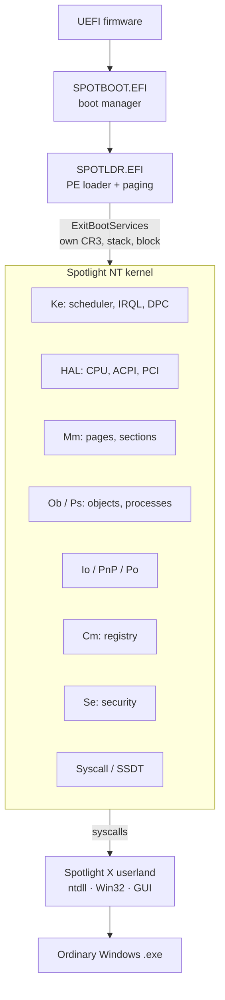

<div align="center">

# Spotlight

### An open-source operating system being built to run Windows applications — kernel, userland and installer, all from scratch.

**Spotlight NT** is the NT kernel. **Spotlight X** is the operating system built on it.
**Spotlight PE** is the installer and recovery environment.

<br>


```
Spotlight NT     ██████████████░░░░░░  74%   kernel: M0–M2 closed, M3 75%, M4 65%, M5 65%, M6 96%, M10 37%
Spotlight X      █░░░░░░░░░░░░░░░░░░░   7%   bootstrap GPT/FAT32 image; userland skeleton
Spotlight PE     █░░░░░░░░░░░░░░░░░░░   8%   installer core, rollback, host console, ISO
Spotlight        ████████░░░░░░░░░░░░  45%   the project as a product (target: L3)
```

</div>

---

## What is this?

Spotlight is not a Linux distribution, not a Wine wrapper and not an emulator.
It is a clean-room operating system in three parts: a new NT kernel, a new
userland with a Win32 layer, and an installer environment — being built so
ordinary Windows `.exe` files can run on bare metal.

| Piece | Role | Repository |
|---|---|---|
| **Spotlight NT** | kernel, boot chain, drivers, ABI specifications | [`spotlight-nt`](https://github.com/fluidmstr/spotlight-nt) |
| **Spotlight X** | userland, Win32 layer, GUI, distribution | [`spotlight-x`](https://github.com/fluidmstr/spotlight-x) |
| **Spotlight PE** | minimal installer / recovery environment | [`spotlight-pe`](https://github.com/fluidmstr/spotlight-pe) |

The target ABI is frozen at **Windows 10 x64 22H2 (build 19045)**. One reference,
one truth, no guessing.

---

## Project readiness

Four independent scales, so nobody confuses a working kernel with a working OS.

| Scale | What it measures | Progress | Works today | Next |
|---|---|---|---|---|
| **Spotlight NT** | kernel, loader, HAL, drivers, ABI | **74%** (M0–M2 ✅, M3 75%, M4 65%, M5 65%, M6 96%, M10 37%) | boots on UEFI, COM1 klog, descriptors, interrupts, ACPI/APIC, PCI, PFN/paging/VAD, anonymous, file-backed and `SEC_IMAGE` NT sections with demand paging, 95 NT syscalls, ring-3 SYSCALL with stack arguments, preemptive scheduler, user thread creation (`NtCreateThreadEx`), thread exit/dequeue, non-consumptive post-exit wait and `ThreadBasicInformation` through a kind-12 handle, user APC delivery through a ring-3 trampoline, PE32+ loader with IAT/TEB/PEB/process CR3, polling AHCI (READ/WRITE DMA) + FAT32 read/write behind a VFS volume with synchronous whole-image flush, rename and delete-on-close, file disposition modes, FAT32 subdirectory paths and DOS creation/write timestamps surfaced as FILETIMEs (`FileBasicInformation`, `FileAllInformation`, `FileNetworkOpenInformation`), event/mutant/semaphore/timer objects with named opens, single- and multi-object scheduler-blocking waits (`test-blocking-wait`), object namespace (`\KnownDlls`, `\BaseNamedObjects`, directory and symbolic-link objects), I/O completion ports, direct virtual-memory read/write, in-memory registry, token queries and timed delays, NTFS parser | M4: working sets/COW; M5: priorities/idle/thread join (stack reclamation); M6: APC context and broader dispatch; M8: hives; M10: ext4, partial/async flush, write-back cache, nested-path creation |
| **Spotlight X** | userland, Win32 layer, GUI, distro | **7%** (bootstrap image + userland specs) | repository layout, freestanding PE32+ `hello.exe` seed (13 host tests, 2 KB, no imports), deterministic 64 MiB GPT/FAT32 image with boot artifacts + hello + config; QEMU/OVMF boots to HAL init | ntdll/PE-loader integration that launches `\X\hello.exe`, then Win32 |
| **Spotlight PE** | installer / recovery environment | **8%** (docs + host-tested installer core) | state machine, durable journal, dry-run and file-backed apply, journal-driven `no-gpt` rollback, host console/init, deterministic GPT/FAT32 image and unsigned ISO 9660/El Torito media; QEMU/OVMF reaches the kernel, not a PE session | bootable `spotpe-init`, real disk adapter, interactive installer |
| **Spotlight** | the project as a product | **45%** | honest start: a reproducible kernel bring-up with tests | L1: first ring-3 process and syscall |

> The kernel is ahead of the OS. That is expected: userland and the installer need
> a broad, stable syscall surface, not a handful of handlers.

---

## What the kernel proves today

No screenshots, no promises. These lines are produced by the kernel in QEMU:

```
Spotlight loader 26.1.4280.0.1-dev
loader: read 7680 bytes
loader: image at 0x7bd37000 relocs 32
loader: stack 0x7bd37000 block 0x7e4b6000 map 5280
I [boot] KiSystemStartup entered
I [boot] loader block accepted
I [boot] image_base=0x7bd37000
I [ke] GDT, TSS and IDT loaded; exceptions report to debugcon
I [ke] KPCR installed at GS base
I [ke] syscall-armed
I [ke] irql=0x0
I [ke] irql_raised=0x2
I [acpi] lapic_base=0xfee00000
I [acpi] ioapic_base=0xfec00000
I [hal] lapic_id=0x0
I [hal] ioapic_version=0x170020
I [hal] PIC and PIT ready; enabling interrupts
I [hal] pit_ticks=0x3
I [hal] PIC and PIT masked; LAPIC timer is the time source
I [hal] lapic_timer-ok
I [hal] lapic_timer_ticks=0xa
I [hal] lapic_bus_hz=0x3b735060
I [hal] ioapic_gsi0=0x2
I [hal] ioapic_irq-ok
I [hal] ioapic_irq_ticks=0x5
I [pci] devices=0x6
I [pci] first=0x29c08086
I [mm] free_pages=0x7ac8f
I [mm] paging-on
I [mm] cr3=0x100000
I [mm] alloc-free-ok
I [mm] pool-ok
I [mm] vad-ok
I [mm] mappings=0x1
I [mm] demand-ok
I [serial] loopback self-test passed
```

And the machine itself proves the rest:

| Test | Command | Result |
|---|---|---|
| Boot regression | `v run mk/build.vsh -- test-boot` | 38/38 serial expectations |
| Page fault | `v run mk/build.vsh -- test-pf` | `PF cr2=0x100000000`, bugcheck `0x50000020` |
| Demand paging | `v run mk/build.vsh -- test-demand` | three faults above 4 GiB, `demand-ok` |
| Syscall entry | `v run mk/build.vsh -- test-syscall` | `syscall=0x0`, `syscall=0x1000`, `syscall-ok` |
| Ring-3 round-trip | `v run mk/build.vsh -- test-ring3` | `ring3-buf`, `syscall-arg1=0x1dc7ab192810000`, `syscall-user-ok` |
| Misc services | `v run mk/build.vsh -- test-misc` | `timer-resolution=`, `open-process=`, `open-thread=`, `misc-ok` |
| First handler | `NtQuerySystemTime` (0x5a) | reads `KUSER_SHARED_DATA`, writes the user buffer |
| PS skeleton | boot log | `ps-ready`, `dtb=0x100000`, `syscall-stack=0x...` |
| Threads + CR3 | `v run mk/build.vsh -- test-threads` | `cr3-b`, `cr3-a`, `sched-tid=0x1`, `thread-b-running`, `thread-a-resumed` |
| Preemption | `v run mk/build.vsh -- test-preempt` | two volatile counters advance, `preempt-ok` |
| PE32+ parser | `v -path "kernel;@vlib" test tests/unit/image` | host suite: headers, sections, RVA, DIR64 |
| PE user entry | `v run mk/build.vsh -- test-pe-user` | `image-base=0x140000000`, `entry=0x140001000`, `pe-exec-ok` |
| PE imports/TEB | `v run mk/build.vsh -- test-exe` | `imports=0x1`, `iat=0x180000000`, `teb=0x170000000`, IAT call, `exe-ok` |
| File-backed .exe | `v run mk/build.vsh -- test-exe-file` | `file-fat32=0x800`, IAT call, `exe-file-ok` |
| Rename / delete-on-close | `v run mk/build.vsh -- test-file` | rename and delete-on-close through FAT32/VFS |
| Named events | `v run mk/build.vsh -- test-event` | named create, open and duplicate |
| Waits | `v run mk/build.vsh -- test-sync` | finite timed single- and multi-object waits (WaitAll/WaitAny) |
| User APCs | `v run mk/build.vsh -- test-apc` | queue → `NtTestAlert` trampoline → routine/resume (`apc-routine-ok`, `apc-resume-ok`) |
| Object namespace | `v run mk/build.vsh -- test-namespace` | directory and symbolic-link objects, named sections, seeded roots |
| I/O completion | `v run mk/build.vsh -- test-iocp` | queue, set, remove and query completion packets |
| Thread/process exit | `v run mk/build.vsh -- test-exit` | termination paths |
| Registry | `v run mk/build.vsh -- test-registry` | in-memory keys/values under `HKLM\Software\Microsoft\Windows NT\CurrentVersion` |
| NTFS parser | `v -path "kernel;@vlib" test tests/unit/fs` | VBR, FILE, USA, attributes, FILE_NAME |
| LAPIC timer | `v run mk/build.vsh -- test-lapic` | `lapic_timer-ok`, PIC/PIT masked |
| Timer interrupts | `v run mk/build.vsh -- test-timer` | 10 PIT ticks, `pit_timer-ok` |
| Exception routing | `v run mk/build.vsh -- test-exception` | `EXC 3` on debugcon |
| Bugcheck path | `v run mk/build.vsh -- test-bugcheck` | `BUGCHECK 0x50000001` |
| Host unit tests | `v run mk/build.vsh -- test` | PE, memory, SSDT/symgen, scheduler, RTC, image and FAT32/NTFS suites green |

### Recent kernel progress (2026-11-27)

* **Boot chain**: `SPOTBOOT.EFI` chain-loads `SPOTLDR.EFI`, which loads
  `ntoskrnl.exe`; the kernel reaches HAL initialization under QEMU/OVMF. The
  smoke run reports `SPOTBOOT true`, `SPOTLDR true` and the kernel marker `true`.
* **95 NT syscalls / 95 SSNs** registered (up from 74; the earlier count missed the
  token/thread SSNs 0x24, 0x2f, 0x41 and the new 0xc2): file I/O
  (`NtCreateFile`, `NtReadFile`,
  `NtWriteFile`, `NtQueryInformationFile`, `NtSetInformationFile`,
  `NtQueryAttributesFile`, `NtQueryFullAttributesFile`,
  `NtFlushBuffersFile`, `NtQueryVolumeInformationFile`,
  `NtQueryDirectoryFile`), memory
  (`NtAllocateVirtualMemory`, `NtFreeVirtualMemory`, `NtProtectVirtualMemory`,
  `NtReadVirtualMemory` 0x3f, `NtWriteVirtualMemory` 0x3a,
  `NtLockVirtualMemory` 0x10e, `NtUnlockVirtualMemory` 0x1cd,
  `NtFlushVirtualMemory` 0xec, `NtCreateSection`, `NtQuerySection`,
  `NtMapViewOfSection`, `NtUnmapViewOfSection`, `NtOpenSection` 0x37), events
  (`NtCreateEvent`, `NtOpenEvent` 0x40, `NtSetEvent`, `NtResetEvent` 0x17a,
  `NtQueryEvent`), object
  information (`NtClose`, `NtQueryObject`, `NtOpenProcess` and `NtOpenThread`
  0x12f returning the current-process/thread pseudo-handles,
  `NtDuplicateObject` 0x3c with reference-counted aliases), thread
  information (`NtQueryInformationThread`, `NtSetInformationThread`),
  named objects and opens (`NtOpenEvent` 0x40, `NtOpenMutant` 0x125,
  `NtOpenSemaphore` 0x12c, `NtOpenTimer` 0x130),
  process/thread control (`NtTerminateProcess` 0x2c, `NtTerminateThread` 0x53 —
  a created thread's kind-12 handle records the exit code and leaves the ready
  queue, the current-thread pseudo-handle logs and parks — `NtTestAlert` 0x1c2,
  `NtAlertThread` 0x6f,
  `NtAlertThreadByThreadId` 0x70; `NtQueueApcThread` 0x45 queues a user APC that is
  delivered at `NtTestAlert` or an alertable wait through a mapped ring-3
  trampoline — the routine receives 3 arguments and execution resumes at the
  interrupted RIP, `test-apc`; `NtCreateThreadEx` 0xc2 allocates a user stack and
  a dynamic ETHREAD slot, inserts the thread into the ready queue and starts it
  in ring 3 — `test-thread-create`; after exit the same handle is waitable
  (non-consumptive) and queryable through `NtQueryInformationThread` class 0
  `ThreadBasicInformation` — `test-thread-exit`), timing and waits (`NtDelayExecution`,
  `NtQueryPerformanceCounter`, `NtQuerySystemTime`, `NtWaitForSingleObject`
  blocking on its own syscall stack and resuming on signal or the TSC deadline, `NtWaitForMultipleObjects` 0x5b,
  `NtWaitForMultipleObjects32` 0x1a — WaitAll/WaitAny over events, mutants,
  semaphores and timers — `NtQueryTimerResolution`, `NtSetTimerResolution`),
  process/system queries (`NtQueryInformationProcess`,
  `NtSetInformationProcess` 0x1c for priority class and execute flags,
  `NtQuerySystemInformation`, `NtQueryVirtualMemory`, `NtYieldExecution`),
  mutants (`NtCreateMutant` 0xb4, `NtReleaseMutant` 0x20, `NtQueryMutant` 0x156
  with `MutantBasicInformation`), semaphores (`NtReleaseSemaphore` 0x0a,
  `NtCreateSemaphore` 0xc0, `NtQuerySemaphore` 0x15e with
  `SemaphoreBasicInformation`), timers (`NtCreateTimer` 0xc3, `NtSetTimer` 0x62,
  `NtCancelTimer` 0x61, `NtQueryTimer` 0x38 with `TimerBasicInformation`),
  object namespace (`NtCreateDirectoryObject` 0xa7, `NtOpenDirectoryObject` 0x58,
  `NtQueryDirectoryObject` 0x144, `NtCreateSymbolicLinkObject` 0xc1,
  `NtOpenSymbolicLinkObject` 0x12e, `NtQuerySymbolicLinkObject` 0x15f; named
  sections with one-level link resolution; seeded `\KnownDlls`,
  `\BaseNamedObjects`, `\Device` and `\??`), I/O completion
  (`NtCreateIoCompletion` 0xad, `NtSetIoCompletion` 0x1a3,
  `NtRemoveIoCompletion` 0x09, `NtQueryIoCompletion` 0x153),
  in-memory registry (`NtOpenKey` 0x12, `NtCreateKey` 0x1d, `NtQueryKey` 0x16,
  `NtQueryValueKey` 0x17, `NtEnumerateKey` 0x32, `NtEnumerateValueKey` 0x13,
  `NtSetValueKey` 0x60, `NtDeleteKey` 0xd4, `NtDeleteValueKey` 0xd7,
  `NtFlushKey` 0xea; seeded from
  `HKLM\Software\Microsoft\Windows NT\CurrentVersion`, no hives yet),
  tokens (`NtOpenProcessToken` 0x129, `NtOpenProcessTokenEx` 0x30,
  `NtQueryInformationToken` 0x21; classes 8/10/18/20: `TokenType` →
  `TokenPrimary`, `TokenStatistics`, `TokenElevationType` →
  `TokenElevationTypeDefault`, `TokenElevation` → not elevated) and
  instruction-cache maintenance (`NtFlushInstructionCache`, a validated no-op on
  x86). Path-based attribute queries (`NtQueryAttributesFile` 0x3d,
  `NtQueryFullAttributesFile` 0x147) return `FILE_BASIC_INFORMATION` and
  `FILE_NETWORK_OPEN_INFORMATION`; `NtSetInformationFile` class 4 updates file
  attributes, `FileRenameInformation` renames and `FileDispositionInformation`
  deletes on close (proven by `test-file`). `NtCreateFile` honours
  `FILE_SUPERSEDE`/`OPEN`/`CREATE`/`OPEN_IF`/`OVERWRITE`/`OVERWRITE_IF` with FAT32
  cluster allocation and growth. File handles carry DOS creation/write timestamps
  (set on create, overwrite and write) and return them as FILETIMEs through
  `FileBasicInformation`, `FileAllInformation` and `FileNetworkOpenInformation`;
  `test-file` asserts a non-zero write time and a non-zero directory-creation
  time. Info classes cover file
  4–9/14/16/17/21/22/34/35/39, process 0/2/3/4/5/7/12/18/20–22/24–34/36/43,
  system 0/1/3/5/7/8/9/23/35/103 and token 8/10/18/20.
  Signaled, zero-timeout and finite timed waits work, including multi-object
  waits (`test-sync`); `NtWaitForSingleObject` acquires an unowned mutant or one
  owned by the current thread, decrements a positive semaphore count and fires
  when a timer expires; releasing past a semaphore's maximum returns
  `STATUS_SEMAPHORE_LIMIT_EXCEEDED`. An unsignaled non-zero-timeout wait
  dequeues the thread and resumes on the same syscall stack after a signal or the
  TSC deadline; `test-blocking-wait` observes zero poll iterations. User APC
  delivery restores `RAX`/`RBP` but not the full volatile register context.
* **Storage**: polling AHCI (`READ DMA`/`WRITE DMA`, SPOTFAT port selection),
  FAT32 read and in-place write with cluster allocation on growth, FAT32 path
  resolution through subdirectories for open/read/query (creation and writes
  remain root-only), DOS creation/write timestamps in directory entries, and a
  published VFS volume over a 64 KiB disk image.
  `NtWriteFile` writes through to the cached volume; `NtFlushBuffersFile`
  synchronously writes the whole 64 KiB image to the SATA disk.
* **Memory**: anonymous, file-backed and `SEC_IMAGE` NT sections with demand
  paging, a user VA allocator above 8 GiB, and direct user-memory access through
  `NtReadVirtualMemory`/`NtWriteVirtualMemory`.
* **Ring 3**: the PE loader (IAT/TEB/PEB) runs at CPL3, and a multi-argument
  `SYSCALL` entry — including arguments passed on the stack — is proven by
  `test-svc3`.
* **Scheduling**: preemptive round-robin with the LAPIC timer.
* **ABI**: syscall numbers re-checked against the 19045 reference, correcting
  `NtOpenThread` to 0x12f and `NtResetEvent` to 0x17a; host assertions cover RTL
  types and `OBJECT_HEADER`, and `kpcr_init` refuses to boot if the documented
  GS offsets drift from the V layout.

29 QEMU test targets plus the host FAT32 and unit suites are green, including
`test-boot`, `test-disk`, `test-file`, `test-section`, `test-event`,
`test-namespace`, `test-iocp`, `test-sync`, `test-blocking-wait`, `test-apc`,
`test-thread-create`, `test-thread-exit`, `test-exit`, `test-registry`, `test-svc`,
`test-svc3`, `test-misc` and `test-preempt`. There is still no real Windows `.exe` (L3),
no ntdll/Win32/GUI, no installer running on the kernel, no real process creation
(threads are created through `NtCreateThreadEx`; join/stack reclamation is missing),
no SMP, and no COW or pagefile. Nested-path file creation and writes are not implemented.

What this means: our own UEFI boot manager chain-loads our loader, which reads a PE32+ kernel, allocates pages, applies
relocations, exits boot services, builds its own page tables, switches CR3, installs
a kernel stack and enters `KiSystemStartup`. The kernel brings up COM1, GDT, TSS,
IDT, exception handling, the per-CPU GS base, hardware interrupts, the first
M3 pieces — ACPI/MADT, LAPIC/IOAPIC and IRQL — and finally hands timekeeping to
the LAPIC timer while retiring the 8259 and PIT.

---

## Spotlight NT — kernel stages

```
M0  ████████████████████ 100%   Bare-metal V: UEFI app boots in QEMU/OVMF
M1  ████████████████████ 100%   Loader: PE32+, ExitBootServices, own CR3, handoff
M2  ████████████████████ 100%   Kernel bring-up: serial, GDT/IDT, KPCR, IRQ, bugcheck
M3  ███████████████░░░░░  75%   HAL: ACPI/MADT, LAPIC/IOAPIC, IRQL, timers, PCI
M4  █████████████░░░░░░░  65%   Memory manager: PFN, paging, VAD, NT sections, demand
M5  ████████████░░░░░░░░  65%   Processes/threads: blocking waits, round-robin, CR3, create/exit, APC
M6  ███████████████████░  96%   Syscalls: 95 NT handlers, namespace, IOCP, waits, registry, APCs
M7  ░░░░░░░░░░░░░░░░░░░░   0%   I/O manager, PnP, power  ← gate G2
M8  ░░░░░░░░░░░░░░░░░░░░   0%   Registry, hives, transactions
M9  ░░░░░░░░░░░░░░░░░░░░   0%   Security: tokens, ACL, integrity
M10 ███████░░░░░░░░░░░░░  37%   Storage: AHCI, FAT32 read/write, subdirectory paths, DOS timestamps, whole-image flush, NTFS parser
M11 ░░░░░░░░░░░░░░░░░░░░   0%   ntdll, ALPC, console
M12 ░░░░░░░░░░░░░░░░░░░░   0%   Win32 layer, application corpus  → L3
M13 ░░░░░░░░░░░░░░░░░░░░   0%   Track A research: real MS drivers/userland
M14 ░░░░░░░░░░░░░░░░░░░░   0%   Spotlight X 1.0: image, installer, release
```

| Stage | Scope | State | Evidence |
|---|---|---|---|
| **M0** | UEFI app on V, zero libc | ✅ closed | banner + memory map in QEMU/OVMF |
| **M1** | loader, PE32+, ExitBootServices, CR3 | ✅ closed | `EXIT / PGON / JUMP` on debugcon |
| **M2** | COM1, GDT/TSS/IDT, KPCR, PIC/PIT, bugcheck | ✅ closed | serial log, `EXC 3`, `BUGCHECK 0x50000001`, `pit_ticks=0x3` |
| **M3** | ACPI/MADT, LAPIC/IOAPIC, IRQL, timers, PCI | 🟡 75% | `lapic_bus_hz≈998MHz`, `ioapic_irq-ok`, `pci devices=6` |
| **M4** | Mm: PFN page database, kernel pool, page tables, VAD, sections | 🟡 65% | `paging-on`, `vad-ok`, `demand-ok`, anonymous, file-backed and `SEC_IMAGE` NT sections (`test-section`, `test-section-file`, `test-section-image`) |
| **M5** | Ob/Ps: objects, processes, threads, scheduler | 🟡 65% | `preempt-ok`, `sched-tid=0x1`, `cr3-b`/`cr3-a`, `thread-a-resumed`, `test-thread-create` ring-3 start, `test-thread-exit`, `test-blocking-wait` (block, signal/timeout resume, zero polls), `test-exit`, `test-apc` |
| **M6** | Syscall entry + dispatch, ring 3, PE loader | 🟡 96% | 95 NT handlers; `test-svc3` multi-argument SYSCALL incl. stack args; APC delivery/resume; events, namespace, IOCP, blocking waits, registry, file timestamps, RTL/OBJECT_HEADER/KPCR ABI checks |
| **M10** | Storage: VFS, FAT32/ext4/NTFS/btrfs, Cc | 🟡 37% | `test-disk`/`test-file`/`test-flush`: AHCI + FAT32 read/write with cluster growth, subdirectory path resolution, rename and delete-on-close, DOS creation/write timestamps exposed as FILETIMEs, VFS volume, 64 KiB image, whole-image flush re-read; NTFS parser |
| M7–M9, M11–M12 | Io, Cm, Se, ntdll, Win32 | ⬜ | — |
| M13 | Track A: Microsoft drivers and userland | 🔬 research | gated by G2 |
| M14 | distributable OS image | ⬜ | — |

---

## Spotlight X and Spotlight PE

The public project is not the kernel alone. X now has a tested bootstrap disk image and PE has a
host-tested installer/recovery stack plus bootable installation media, but neither has a ring-3
session running on the kernel.

| | Spotlight X | Spotlight PE |
|---|---|---|
| **Today** | userland/distro skeleton, freestanding PE32+ `hello.exe` seed (13 host tests, 2 KB), deterministic GPT/FAT32 bootstrap image; QEMU/OVMF boots to HAL init, but hello is not launched | installer/recovery design, host console/init, state machine, journal, dry-run/file-backed apply, `no-gpt` rollback, GPT/FAT32 image and unsigned ISO 9660/El Torito media; QEMU/OVMF reaches the kernel, not PE |
| **Blocked on** | kernel integration that loads `\X\hello.exe` into a process (L1) and ntdll | bootable PE userland on the kernel, then real disk adapter and interactive flow |
| **Next** | ntdll syscall stubs and a kernel-side launch test for the existing hello PE | boot `spotpe-init`, explorer/UI, physical disk adapter |
| **Progress** | 7% | 8% |

### Not a Windows clone

Spotlight X keeps Windows binary compatibility but not Windows' internal
choices:

* **`X:\` is the native root.** Win32 processes see `C:\` as a per-process bind
  alias of `X:\`, so `.exe` installers keep working without a separate volume.
* **Multi-filesystem VFS.** ext4 is the default root, FAT32 is the ESP, NTFS is
  a read-only (later rw) compatibility backend, btrfs comes after VFS
  stabilisation. NTFS is one backend, not the centre of the OS.
* **Terminal fallback.** `spotinit` starts the desktop session; if it is absent
  or crashes, `spotterm` starts on the console (framebuffer or COM1). Recovery
  never leaves a black screen.
* **Graphics without WDDM.** Own kernel GPU drivers + a DRM-like UAPI for
  upstream Mesa (RADV/ANV/NVK, MIT) and DXVK/D8VK (zlib) / VKD3D-Proton
  (LGPL-2.1+, isolated). Windows WDDM drivers are not the path: they are
  closed, version-locked and a larger subsystem than the current kernel.
* Details: ADR-0010 (namespace/filesystems), ADR-0011 (graphics), ADR-0012
  (session fallback) in `spotlight-nt/docs/adr/`.

That is why the overall project sits at 45% while the kernel is at 74%: the OS
needs the kernel to finish first, not the other way around.

---

## The compatibility ladder

"Compatible" is not a feeling. It is a ladder with measurable rungs.

| Level | Meaning | State |
|---|---|---|
| **L0** | our loader + our kernel boot on UEFI | ✅ done |
| **L1** | ring-3 process, syscall round-trip | ⬜ |
| **L2** | our ntdll + kernel32 + CRT, our own programs | ⬜ |
| **L3** | **20 third-party `.exe` files pass checklists** — the 1.0 target | ⬜ |
| **L4** | real Microsoft drivers (`acpi.sys`, `storport.sys`, `ntfs.sys`) | ⬜ |
| **L5** | real Windows 10 userland on our kernel | 🔬 research |

> **L3 is the product.** L4 and L5 are proof of depth, not a release condition.

---

## Architecture



Detailed design lives in [`spotlight-nt/docs`](https://github.com/fluidmstr/spotlight-nt/tree/main/docs).

---

## Try it now

You will get a serial log and the kernel's self-tests — not a desktop. That is the honest state.

```bash
git clone --recursive https://github.com/fluidmstr/spotlight-x.git
cd spotlight-x/kernel

v run mk/build.vsh -- test        # host unit tests
v run mk/build.vsh -- run-efi     # build everything and boot in QEMU
```

Expected tail of `build/serial.log`:

```
I [boot] KiSystemStartup entered
I [ke] GDT, TSS and IDT loaded; exceptions report to debugcon
I [ke] KPCR installed at GS base
I [ke] syscall-armed
I [ke] irql=0x0
I [ke] irql_raised=0x2
I [acpi] lapic_base=0xfee00000
I [acpi] ioapic_base=0xfec00000
I [hal] lapic_id=0x0
I [hal] ioapic_version=0x170020
I [hal] PIC and PIT ready; enabling interrupts
I [hal] pit_ticks=0x3
I [hal] PIC and PIT masked; LAPIC timer is the time source
I [hal] lapic_timer-ok
I [hal] lapic_timer_ticks=0xa
I [hal] lapic_bus_hz=0x3b735060
I [hal] ioapic_gsi0=0x2
I [hal] ioapic_irq-ok
I [hal] ioapic_irq_ticks=0x5
I [pci] devices=0x6
I [pci] first=0x29c08086
I [mm] free_pages=0x7ac8f
I [mm] paging-on
I [mm] cr3=0x100000
I [mm] alloc-free-ok
I [mm] pool-ok
I [mm] vad-ok
I [mm] mappings=0x1
I [mm] demand-ok
I [serial] loopback self-test passed
```

Requirements: Windows x64, **V 0.5.2**, LLVM/clang + lld, QEMU with OVMF.
Step-by-step: [`docs/Installation.md`](docs/Installation.md).

---

## Documentation

| Guide | What is inside |
|---|---|
| [Installation](docs/Installation.md) | toolchain, clone, first boot |
| [Building](docs/Building.md) | targets, flags, artifacts, freestanding profile |
| [Running in QEMU](docs/Running-in-QEMU.md) | firmware, serial, debugcon, environment |
| [Boot Testing](docs/Boot-Testing.md) | expectation harness and regression matrix |
| [Architecture](docs/Architecture.md) | boot chain, components, ABI contracts |
| [Roadmap](docs/Roadmap.md) | M0–M14, L0–L5, gate G2 |
| [Compatibility](docs/Compatibility.md) | what runs today, path to `.exe` |
| [Troubleshooting](docs/Troubleshooting.md) | known failures and fixes |
| [Contributing](docs/Contributing.md) | rules, scopes, good first tasks |
| [Legal](docs/Legal.md) | licensing, clean room, symbols |
| [Reference Windows](docs/Reference-Windows.md) | how a licensed Windows is used as an ABI oracle |
| [FAQ](docs/FAQ.md) | short answers to hard questions |
| [Changelog](CHANGELOG.md) | what shipped, with evidence |

---

## Principles

> **A kernel is not a feature. It is a contract with every program you will ever run.**

> **No magic.** If we cannot explain why it works, it does not work.

> **No lying stubs.** Unimplemented means `STATUS_NOT_IMPLEMENTED`, not "success".

> **Boot, observe, prove.** Every milestone ships with a log line or a test that fails without it.

> **One ABI.** Windows 10 x64 19045. Everything else is a branch.

---

## Legal

Spotlight is **GPL-2.0-or-later**. It contains no Microsoft code or binaries.
It is not affiliated with Microsoft. Names are used descriptively only.
See [docs/Legal.md](docs/Legal.md) and [`spotlight-nt/docs/06-risks-legal.md`](https://github.com/fluidmstr/spotlight-nt/blob/main/docs/06-risks-legal.md).

<div align="center">

**Build the kernel. Earn the applications.**

</div>
