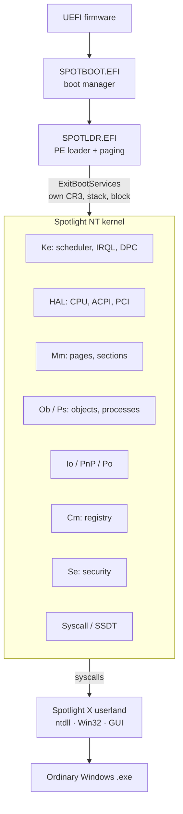

<div align="center">

# Spotlight

### An open-source operating system that runs Windows applications — kernel, userland and installer, built from scratch.

**Spotlight NT** is the NT kernel. **Spotlight X** is the operating system built on it.
**Spotlight PE** is the installer and recovery environment.

<br>


```
Spotlight NT     ████████░░░░░░░░░░░░  41%   kernel: M0–M2 closed, M3 75%, M4 40%, M5 15%, M6 40%
Spotlight X      █░░░░░░░░░░░░░░░░░░░   5%   userland, Win32, GUI, distro — skeleton + specs
Spotlight PE     █░░░░░░░░░░░░░░░░░░░   5%   installer environment — docs + build skeleton
Spotlight        █████░░░░░░░░░░░░░░░  25%   the project as a product (target: L3)
```

</div>

---

## What is this?

Spotlight is not a Linux distribution, not a Wine wrapper and not an emulator.
It is a clean-room operating system in three parts: a new NT kernel, a new
userland with a Win32 layer, and an installer environment — built so ordinary
Windows `.exe` files can run on bare metal.

| Piece | Role | Repository |
|---|---|---|
| **Spotlight NT** | kernel, boot chain, drivers, ABI specifications | [`spotlight-nt`](https://github.com/fluidmstr/spotlight-nt) |
| **Spotlight X** | userland, Win32 layer, GUI, distribution | [`spotlight-x`](https://github.com/fluidmstr/spotlight-x) |
| **Spotlight PE** | minimal installer / recovery environment | [`spotlight-pe`](https://github.com/fluidmstr/spotlight-pe) |

The target ABI is frozen at **Windows 10 x64 22H2 (build 19045)**. One reference,
one truth, no guessing.

---

## Project readiness

Four independent scales, so nobody confuses a working kernel with a working OS.

| Scale | What it measures | Progress | Works today | Next |
|---|---|---|---|---|
| **Spotlight NT** | kernel, loader, HAL, drivers, ABI | **41%** (M0–M2 ✅, M3 75%, M4 40%, M5 15%, M6 40%) | boots on UEFI, COM1 klog, descriptors, interrupts, ACPI/APIC, PCI, PFN/paging/VAD, demand-paged sections, SSDT, ring-3 SYSCALL, `NtQuerySystemTime`, user `KUSER_SHARED_DATA`, CR3 + cooperative threads, ready queues, RTC time, PE32+ parser | M4: working sets/COW; M5: preemption; M6: more handlers |
| **Spotlight X** | userland, Win32 layer, GUI, distro | **5%** (skeleton + specs) | repository layout, architecture and app-compatibility plans | ntdll and PE loader behind syscalls (needs L1) |
| **Spotlight PE** | installer / recovery environment | **5%** (docs + build script) | repo, subsystem docs, `mk/build.vsh` skeleton | console/explorer on the kernel, installer flow |
| **Spotlight** | the project as a product | **25%** | honest start: a reproducible kernel bring-up with tests | L1: first ring-3 process and syscall |

> The kernel is ahead of the OS. That is expected: userland and the installer are
> blocked on syscalls, which are blocked on the memory manager and process objects.

---

## What the kernel proves today

No screenshots, no promises. These lines are produced by the kernel in QEMU:

```
Spotlight loader 26.4173.0.1
loader: read 7680 bytes
loader: image at 0x7bd37000 relocs 32
loader: stack 0x7bd37000 block 0x7e4b6000 map 5280
I [boot] KiSystemStartup entered
I [boot] loader block accepted
I [boot] image_base=0x7bd37000
I [ke] GDT, TSS and IDT loaded; exceptions report to debugcon
I [ke] KPCR installed at GS base
I [ke] syscall-armed
I [ke] irql=0x0
I [ke] irql_raised=0x2
I [acpi] lapic_base=0xfee00000
I [acpi] ioapic_base=0xfec00000
I [hal] lapic_id=0x0
I [hal] ioapic_version=0x170020
I [hal] PIC and PIT ready; enabling interrupts
I [hal] pit_ticks=0x3
I [hal] PIC and PIT masked; LAPIC timer is the time source
I [hal] lapic_timer-ok
I [hal] lapic_timer_ticks=0xa
I [hal] lapic_bus_hz=0x3b735060
I [hal] ioapic_gsi0=0x2
I [hal] ioapic_irq-ok
I [hal] ioapic_irq_ticks=0x5
I [pci] devices=0x6
I [pci] first=0x29c08086
I [mm] free_pages=0x7ac8f
I [mm] paging-on
I [mm] cr3=0x100000
I [mm] alloc-free-ok
I [mm] pool-ok
I [mm] vad-ok
I [mm] mappings=0x1
I [mm] demand-ok
I [serial] loopback self-test passed
```

And the machine itself proves the rest:

| Test | Command | Result |
|---|---|---|
| Boot regression | `v run mk/build.vsh -- test-boot` | 33/33 serial expectations |
| Page fault | `v run mk/build.vsh -- test-pf` | `PF cr2=0x100000000`, bugcheck `0x50000020` |
| Demand paging | `v run mk/build.vsh -- test-demand` | three faults above 4 GiB, `demand-ok` |
| Syscall entry | `v run mk/build.vsh -- test-syscall` | `syscall=0x0`, `syscall=0x1000`, `syscall-ok` |
| Ring-3 round-trip | `v run mk/build.vsh -- test-ring3` | `ring3-buf`, `syscall-arg1=0x1dc7ab192810000`, `syscall-user-ok` |
| First handler | `NtQuerySystemTime` (0x5a) | reads `KUSER_SHARED_DATA`, writes the user buffer |
| PS skeleton | boot log | `ps-ready`, `dtb=0x100000`, `syscall-stack=0x...` |
| Threads + CR3 | `v run mk/build.vsh -- test-threads` | `cr3-b`, `cr3-a`, `sched-tid=0x1`, `thread-b-running`, `thread-a-resumed` |
| PE32+ parser | `v -path "kernel;@vlib" test tests/unit/image` | host suite: headers, sections, RVA, DIR64 |
| LAPIC timer | `v run mk/build.vsh -- test-lapic` | `lapic_timer-ok`, PIC/PIT masked |
| Timer interrupts | `v run mk/build.vsh -- test-timer` | 10 PIT ticks, `pit_timer-ok` |
| Exception routing | `v run mk/build.vsh -- test-exception` | `EXC 3` on debugcon |
| Bugcheck path | `v run mk/build.vsh -- test-bugcheck` | `BUGCHECK 0x50000001` |
| Host unit tests | `v run mk/build.vsh -- test` | 5/5 suites |

What this means: our own UEFI loader reads a PE32+ kernel, allocates pages, applies
relocations, exits boot services, builds its own page tables, switches CR3, installs
a kernel stack and enters `KiSystemStartup`. The kernel brings up COM1, GDT, TSS,
IDT, exception handling, the per-CPU GS base, hardware interrupts, the first
M3 pieces — ACPI/MADT, LAPIC/IOAPIC and IRQL — and finally hands timekeeping to
the LAPIC timer while retiring the 8259 and PIT.

---

## Spotlight NT — kernel stages

```
M0  ████████████████████ 100%   Bare-metal V: UEFI app boots in QEMU/OVMF
M1  ████████████████████ 100%   Loader: PE32+, ExitBootServices, own CR3, handoff
M2  ████████████████████ 100%   Kernel bring-up: serial, GDT/IDT, KPCR, IRQ, bugcheck
M3  ███████████████░░░░░  75%   HAL: ACPI/MADT, LAPIC/IOAPIC, IRQL, timers, PCI
M4  ████████░░░░░░░░░░░░  40%   Memory manager: PFN, paging, sections, demand
M5  ███░░░░░░░░░░░░░░░░░  15%   Processes/threads: ready queues, two threads, CR3 switch
M6  ████████░░░░░░░░░░░░  40%   System calls: handler table, ring-3, NtQuerySystemTime, user alias
M7  ░░░░░░░░░░░░░░░░░░░░   0%   I/O manager, PnP, power  ← gate G2
M8  ░░░░░░░░░░░░░░░░░░░░   0%   Registry, hives, transactions
M9  ░░░░░░░░░░░░░░░░░░░░   0%   Security: tokens, ACL, integrity
M10 ░░░░░░░░░░░░░░░░░░░░   0%   Storage, NTFS, cache manager
M11 ░░░░░░░░░░░░░░░░░░░░   0%   ntdll, ALPC, console
M12 ░░░░░░░░░░░░░░░░░░░░   0%   Win32 layer, application corpus  → L3
M13 ░░░░░░░░░░░░░░░░░░░░   0%   Track A research: real MS drivers/userland
M14 ░░░░░░░░░░░░░░░░░░░░   0%   Spotlight X 1.0: image, installer, release
```

| Stage | Scope | State | Evidence |
|---|---|---|---|
| **M0** | UEFI app on V, zero libc | ✅ closed | banner + memory map in QEMU/OVMF |
| **M1** | loader, PE32+, ExitBootServices, CR3 | ✅ closed | `EXIT / PGON / JUMP` on debugcon |
| **M2** | COM1, GDT/TSS/IDT, KPCR, PIC/PIT, bugcheck | ✅ closed | serial log, `EXC 3`, `BUGCHECK 0x50000001`, `pit_ticks=0x3` |
| **M3** | ACPI/MADT, LAPIC/IOAPIC, IRQL, timers, PCI | 🟡 75% | `lapic_bus_hz≈998MHz`, `ioapic_irq-ok`, `pci devices=6` |
| **M4** | Mm: PFN page database, kernel pool, page tables, VAD, sections | 🟡 40% | `paging-on`, `cr3=0x100000`, `vad-ok`, `demand-ok` |
| **M5** | Ob/Ps: objects, processes, threads, scheduler | 🟡 15% | `ps-ready`, `cr3-b`/`cr3-a`, `sched-tid=0x1`, `thread-a-resumed` |
| **M6** | Syscall entry + dispatch, ring 3 | 🟡 40% | `kshared-time=<RTC>`, `kshared-user-ok`, two matching `syscall-arg1`, `syscall-user-ok`, SSDT 473 slots |
| M7–M12 | Io, Cm, Se, NTFS, ntdll, Win32 | ⬜ | — |
| M13 | Track A: Microsoft drivers and userland | 🔬 research | gated by G2 |
| M14 | distributable OS image | ⬜ | — |

---

## Spotlight X and Spotlight PE

The public project is not the kernel alone. The other two pieces exist, but they
are honestly at the planning stage — they cannot run before the kernel exposes
processes and system calls.

| | Spotlight X | Spotlight PE |
|---|---|---|
| **Today** | userland/distro skeleton, architecture and compatibility docs, app-corpus format | installer/recovery design, console/explorer/installer contracts, working `mk/build.vsh` |
| **Blocked on** | syscalls (L1) and object manager (M5) | the same, plus storage (M10) and the X image format |
| **Next** | ntdll skeleton and PE loader behind `Nt*` stubs | console over COM1/framebuffer once ring 3 exists |
| **Progress** | 5% | 5% |

### Not a Windows clone

Spotlight X keeps Windows binary compatibility but not Windows' internal
choices:

* **`X:\` is the native root.** Win32 processes see `C:\` as a per-process bind
  alias of `X:\`, so `.exe` installers keep working without a separate volume.
* **Multi-filesystem VFS.** ext4 is the default root, FAT32 is the ESP, NTFS is
  a read-only (later rw) compatibility backend, btrfs comes after VFS
  stabilisation. NTFS is one backend, not the centre of the OS.
* **Terminal fallback.** `spotinit` starts the desktop session; if it is absent
  or crashes, `spotterm` starts on the console (framebuffer or COM1). Recovery
  never leaves a black screen.
* **Graphics without WDDM.** Own kernel GPU drivers + a DRM-like UAPI for
  upstream Mesa (RADV/ANV/NVK, MIT) and DXVK/D8VK (zlib) / VKD3D-Proton
  (LGPL-2.1+, isolated). Windows WDDM drivers are not the path: they are
  closed, version-locked and a larger subsystem than the current kernel.
* Details: ADR-0010 (namespace/filesystems), ADR-0011 (graphics), ADR-0012
  (session fallback) in `spotlight-nt/docs/adr/`.

That is why the overall project sits at 25% while the kernel is at 41%: the OS
needs the kernel to finish first, not the other way around.

---

## The compatibility ladder

"Compatible" is not a feeling. It is a ladder with measurable rungs.

| Level | Meaning | State |
|---|---|---|
| **L0** | our loader + our kernel boot on UEFI | ✅ done |
| **L1** | ring-3 process, syscall round-trip | ⬜ |
| **L2** | our ntdll + kernel32 + CRT, our own programs | ⬜ |
| **L3** | **20 third-party `.exe` files pass checklists** — the 1.0 target | ⬜ |
| **L4** | real Microsoft drivers (`acpi.sys`, `storport.sys`, `ntfs.sys`) | ⬜ |
| **L5** | real Windows 10 userland on our kernel | 🔬 research |

> **L3 is the product.** L4 and L5 are proof of depth, not a release condition.

---

## Architecture



Detailed design lives in [`spotlight-nt/docs`](https://github.com/fluidmstr/spotlight-nt/tree/main/docs).

---

## Try it now

You will get a serial log and a halted kernel — not a desktop. That is the honest state.

```bash
git clone --recursive https://github.com/fluidmstr/spotlight-x.git
cd spotlight-x/kernel

v run mk/build.vsh -- test        # host unit tests
v run mk/build.vsh -- run-efi     # build everything and boot in QEMU
```

Expected tail of `build/serial.log`:

```
I [boot] KiSystemStartup entered
I [ke] GDT, TSS and IDT loaded; exceptions report to debugcon
I [ke] KPCR installed at GS base
I [ke] syscall-armed
I [ke] irql=0x0
I [ke] irql_raised=0x2
I [acpi] lapic_base=0xfee00000
I [acpi] ioapic_base=0xfec00000
I [hal] lapic_id=0x0
I [hal] ioapic_version=0x170020
I [hal] PIC and PIT ready; enabling interrupts
I [hal] pit_ticks=0x3
I [hal] PIC and PIT masked; LAPIC timer is the time source
I [hal] lapic_timer-ok
I [hal] lapic_timer_ticks=0xa
I [hal] lapic_bus_hz=0x3b735060
I [hal] ioapic_gsi0=0x2
I [hal] ioapic_irq-ok
I [hal] ioapic_irq_ticks=0x5
I [pci] devices=0x6
I [pci] first=0x29c08086
I [mm] free_pages=0x7ac8f
I [mm] paging-on
I [mm] cr3=0x100000
I [mm] alloc-free-ok
I [mm] pool-ok
I [mm] vad-ok
I [mm] mappings=0x1
I [mm] demand-ok
I [serial] loopback self-test passed
```

Requirements: Windows x64, **V 0.5.2**, LLVM/clang + lld, QEMU with OVMF.
Step-by-step: [`docs/Installation.md`](docs/Installation.md).

---

## Documentation

| Guide | What is inside |
|---|---|
| [Installation](docs/Installation.md) | toolchain, clone, first boot |
| [Building](docs/Building.md) | targets, flags, artifacts, freestanding profile |
| [Running in QEMU](docs/Running-in-QEMU.md) | firmware, serial, debugcon, environment |
| [Boot Testing](docs/Boot-Testing.md) | expectation harness and regression matrix |
| [Architecture](docs/Architecture.md) | boot chain, components, ABI contracts |
| [Roadmap](docs/Roadmap.md) | M0–M14, L0–L5, gate G2 |
| [Compatibility](docs/Compatibility.md) | what runs today, path to `.exe` |
| [Troubleshooting](docs/Troubleshooting.md) | known failures and fixes |
| [Contributing](docs/Contributing.md) | rules, scopes, good first tasks |
| [Legal](docs/Legal.md) | licensing, clean room, symbols |
| [Reference Windows](docs/Reference-Windows.md) | how a licensed Windows is used as an ABI oracle |
| [FAQ](docs/FAQ.md) | short answers to hard questions |
| [Changelog](CHANGELOG.md) | what shipped, with evidence |

---

## Principles

> **A kernel is not a feature. It is a contract with every program you will ever run.**

> **No magic.** If we cannot explain why it works, it does not work.

> **No lying stubs.** Unimplemented means `STATUS_NOT_IMPLEMENTED`, not "success".

> **Boot, observe, prove.** Every milestone ships with a log line or a test that fails without it.

> **One ABI.** Windows 10 x64 19045. Everything else is a branch.

---

## Legal

Spotlight is **GPL-2.0-or-later**. It contains no Microsoft code or binaries.
It is not affiliated with Microsoft. Names are used descriptively only.
See [docs/Legal.md](docs/Legal.md) and [`spotlight-nt/docs/06-risks-legal.md`](https://github.com/fluidmstr/spotlight-nt/blob/main/docs/06-risks-legal.md).

<div align="center">

**Build the kernel. Earn the applications.**

</div>
