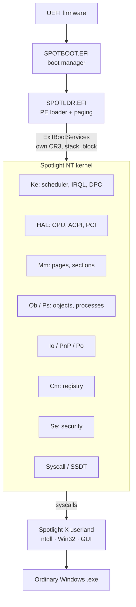

<div align="center">

# Spotlight

### An NT kernel written from scratch in V.

**Spotlight NT** is an open-source implementation of the Windows NT kernel for x86-64.
**Spotlight X** is the operating system built on it. **Spotlight PE** is the installer environment.

<br>


```
Overall   █████░░░░░░░░░░░░░░░░░░░░░░░░░░░░░░░░░░░░░░░░   ~13%  (to L3)
```

</div>

---

## What is this?

Spotlight is not a Linux distribution, not a Wine wrapper, and not an emulator.
It is a clean-room NT kernel: its own loader, its own scheduler, its own memory
manager, its own I/O manager — and, eventually, the ability to run ordinary
Windows `.exe` files on bare metal.

| Piece | Role | Repository |
|---|---|---|
| **Spotlight NT** | kernel, boot chain, drivers, ABI specifications | [`spotlight-nt`](https://github.com/fluidmstr/spotlight-nt) |
| **Spotlight X** | userland, Win32 layer, GUI, distribution | [`spotlight-x`](https://github.com/fluidmstr/spotlight-x) |
| **Spotlight PE** | minimal installer / recovery environment | [`spotlight-pe`](https://github.com/fluidmstr/spotlight-pe) |

The target ABI is frozen at **Windows 10 x64 22H2 (build 19045)**. One reference,
one truth, no guessing.

---

## Status you can verify

No screenshots, no promises. These lines are produced by the kernel in QEMU:

```
Spotlight loader 26.4173.0.1
loader: read 7680 bytes
loader: image at 0x7bd37000 relocs 32
loader: stack 0x7bd37000 block 0x7e4b6000 map 5280
I [boot] KiSystemStartup entered
I [boot] loader block accepted
I [boot] image_base=0x7bd37000
I [ke] GDT, TSS and IDT loaded; exceptions report to debugcon
I [ke] KPCR installed at GS base
I [ke] irql=0x0
I [ke] irql_raised=0x2
I [acpi] lapic_base=0xfee00000
I [acpi] ioapic_base=0xfec00000
I [hal] lapic_id=0x0
I [hal] ioapic_version=0x170020
I [hal] PIC and PIT ready; enabling interrupts
I [hal] pit_ticks=0x3
I [serial] loopback self-test passed
```

And the machine itself proves the rest:

| Test | Command | Result |
|---|---|---|
| Boot regression | `v run mk/build.vsh -- test-boot` | 16/16 serial expectations |
| Timer interrupts | `v run mk/build.vsh -- test-timer` | 10 PIT ticks, `timer-ok` |
| Exception routing | `v run mk/build.vsh -- test-exception` | `EXC 3` on debugcon |
| Bugcheck path | `v run mk/build.vsh -- test-bugcheck` | `BUGCHECK 0x50000001` |
| Host unit tests | `v run mk/build.vsh -- test` | 5/5 suites |

What this means: our own UEFI loader reads a PE32+ kernel, allocates pages, applies
relocations, exits boot services, builds its own page tables, switches CR3, installs
a kernel stack and enters `KiSystemStartup`. The kernel brings up COM1, GDT, TSS,
IDT, exception handling, the per-CPU GS base, hardware interrupts, and the first
M3 pieces — ACPI/MADT, LAPIC/IOAPIC and IRQL.

---

## Stages

```
M0  ████████████████████ 100%   Bare-metal V: UEFI app boots in QEMU/OVMF
M1  ████████████████████ 100%   Loader: PE32+, ExitBootServices, own CR3, handoff
M2  ████████████████████ 100%   Kernel bring-up: serial, GDT/IDT, KPCR, IRQ, bugcheck
M3  ████████░░░░░░░░░░░░  40%   HAL: ACPI/MADT, LAPIC/IOAPIC, IRQL, HPET
M4  ░░░░░░░░░░░░░░░░░░░░   0%   Memory manager: PFN, paging, sections
M5  ░░░░░░░░░░░░░░░░░░░░   0%   Objects, processes, threads
M6  ░░░░░░░░░░░░░░░░░░░░   0%   System calls, first ring-3 process
M7  ░░░░░░░░░░░░░░░░░░░░   0%   I/O manager, PnP, power  ← gate G2
M8  ░░░░░░░░░░░░░░░░░░░░   0%   Registry, hives, transactions
M9  ░░░░░░░░░░░░░░░░░░░░   0%   Security: tokens, ACL, integrity
M10 ░░░░░░░░░░░░░░░░░░░░   0%   Storage, NTFS, cache manager
M11 ░░░░░░░░░░░░░░░░░░░░   0%   ntdll, ALPC, console
M12 ░░░░░░░░░░░░░░░░░░░░   0%   Win32 layer, application corpus  → L3
M13 ░░░░░░░░░░░░░░░░░░░░   0%   Track A research: real MS drivers/userland
M14 ░░░░░░░░░░░░░░░░░░░░   0%   Spotlight X 1.0: image, installer, release
```

| Stage | Scope | State | Evidence |
|---|---|---|---|
| **M0** | UEFI app on V, zero libc | ✅ closed | banner + memory map in QEMU/OVMF |
| **M1** | loader, PE32+, ExitBootServices, CR3 | ✅ closed | `EXIT / PGON / JUMP` on debugcon |
| **M2** | COM1, GDT/TSS/IDT, KPCR, PIC/PIT, bugcheck | ✅ closed | serial log, `EXC 3`, `BUGCHECK 0x50000001`, `pit_ticks=0x3` |
| **M3** | ACPI/MADT, LAPIC/IOAPIC, IRQL, spinlocks, HPET | 🟡 40% | `lapic_base=0xfee00000`, `ioapic_version=0x170020`, `irql 0→2→0` |
| M4–M12 | Mm, Ob/Ps, syscalls, Io, Cm, Se, NTFS, ntdll, Win32 | ⬜ | — |
| M13 | Track A: Microsoft drivers and userland | 🔬 research | gated by G2 |
| M14 | distributable OS image | ⬜ | — |

---

## The compatibility ladder

"Compatible" is not a feeling. It is a ladder with measurable rungs.

| Level | Meaning | State |
|---|---|---|
| **L0** | our loader + our kernel boot on UEFI | ✅ done |
| **L1** | ring-3 process, syscall round-trip | ⬜ |
| **L2** | our ntdll + kernel32 + CRT, our own programs | ⬜ |
| **L3** | **20 third-party `.exe` files pass checklists** — the 1.0 target | ⬜ |
| **L4** | real Microsoft drivers (`acpi.sys`, `storport.sys`, `ntfs.sys`) | ⬜ |
| **L5** | real Windows 10 userland on our kernel | 🔬 research |

> **L3 is the product.** L4 and L5 are proof of depth, not a release condition.

---

## Architecture



Detailed design lives in [`spotlight-nt/docs`](https://github.com/fluidmstr/spotlight-nt/tree/main/docs).

---

## Try it now

You will get a serial log and a halted kernel — not a desktop. That is the honest state.

```bash
git clone --recursive https://github.com/fluidmstr/spotlight-x.git
cd spotlight-x/kernel

v run mk/build.vsh -- test        # host unit tests
v run mk/build.vsh -- run-efi     # build everything and boot in QEMU
```

Expected tail of `build/serial.log`:

```
I [boot] KiSystemStartup entered
I [ke] GDT, TSS and IDT loaded; exceptions report to debugcon
I [ke] KPCR installed at GS base
I [ke] irql=0x0
I [ke] irql_raised=0x2
I [acpi] lapic_base=0xfee00000
I [acpi] ioapic_base=0xfec00000
I [hal] lapic_id=0x0
I [hal] ioapic_version=0x170020
I [hal] PIC and PIT ready; enabling interrupts
I [hal] pit_ticks=0x3
I [serial] loopback self-test passed
```

Requirements: Windows x64, **V 0.5.2**, LLVM/clang + lld, QEMU with OVMF.
Step-by-step: [`docs/Installation.md`](docs/Installation.md).

---

## Documentation

| Guide | What is inside |
|---|---|
| [Installation](docs/Installation.md) | toolchain, clone, first boot |
| [Building](docs/Building.md) | targets, flags, artifacts, freestanding profile |
| [Running in QEMU](docs/Running-in-QEMU.md) | firmware, serial, debugcon, environment |
| [Boot Testing](docs/Boot-Testing.md) | expectation harness and regression matrix |
| [Architecture](docs/Architecture.md) | boot chain, components, ABI contracts |
| [Roadmap](docs/Roadmap.md) | M0–M14, L0–L5, gate G2 |
| [Compatibility](docs/Compatibility.md) | what runs today, path to `.exe` |
| [Troubleshooting](docs/Troubleshooting.md) | known failures and fixes |
| [Contributing](docs/Contributing.md) | rules, scopes, good first tasks |
| [Legal](docs/Legal.md) | licensing, clean room, symbols |
| [FAQ](docs/FAQ.md) | short answers to hard questions |
| [Changelog](CHANGELOG.md) | what shipped, with evidence |

---

## Principles

> **A kernel is not a feature. It is a contract with every program you will ever run.**

> **No magic.** If we cannot explain why it works, it does not work.

> **No lying stubs.** Unimplemented means `STATUS_NOT_IMPLEMENTED`, not "success".

> **Boot, observe, prove.** Every milestone ships with a log line or a test that fails without it.

> **One ABI.** Windows 10 x64 19045. Everything else is a branch.

---

## Legal

Spotlight is **GPL-2.0-or-later**. It contains no Microsoft code or binaries.
It is not affiliated with Microsoft. Names are used descriptively only.
See [docs/Legal.md](docs/Legal.md) and [`spotlight-nt/docs/06-risks-legal.md`](https://github.com/fluidmstr/spotlight-nt/blob/main/docs/06-risks-legal.md).

<div align="center">

**Build the kernel. Earn the applications.**

</div>
